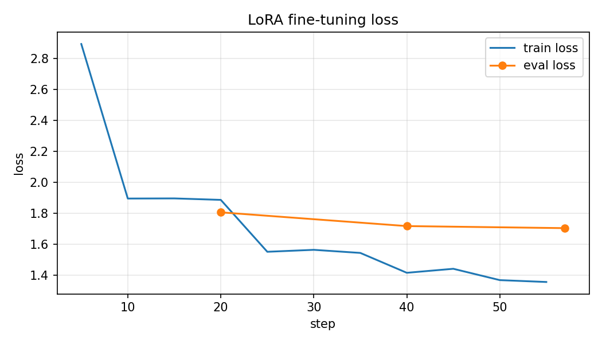

# LoRA Fine-Tuning: Conventional Commit Message Writer

Fine-tunes **Qwen2.5-1.5B-Instruct** with **LoRA** (PEFT + TRL) to turn a git diff into a
one-line [Conventional Commit](https://www.conventionalcommits.org) message.

## Task
Input: a (truncated) git diff. Output: `type(scope): summary`, one line, nothing else.

## Dataset
- Mined from real commits of open-source repos: `<LIST YOUR REPOS HERE>`
- Only commits whose subject already follows Conventional Commits were kept
- Diffs truncated to 1500 chars; lockfiles/minified/svg excluded; de-duplicated
- Split: train `<N>` / val `<N>` / test `<N>` (test is never used in training)
- Format: prompt/completion chat messages (`data/*.jsonl`), loss on completion only

## Training config
| Setting | Value |
|---|---|
| Base model | Qwen/Qwen2.5-1.5B-Instruct |
| LoRA rank / alpha / dropout | 8 / 16 / 0.05 |
| Target modules | q,k,v,o,gate,up,down proj |
| Learning rate | 2e-4 (cosine, 5% warmup) |
| Epochs | 3 |
| Batch | 2 x 8 grad-accum = 16 |
| Max length | 768 tokens |
| Hardware | Colab free T4 |
| Trainable params | `<paste from log>` |
| Training time | `<minutes>` |

## Loss curve


`<Describe: train loss went from X to Y; eval loss from A to B; any overfitting?>`

## Before / After
Same 20 held-out prompts, greedy decoding, same system prompt for both models.
Full outputs: [`results/comparison.md`](results/comparison.md)

`<PASTE the metric table from results/comparison.md>`

Example:
| Diff (summary) | Base | Fine-tuned | Reference |
|---|---|---|---|
| `<…>` | `<…>` | `<…>` | `<…>` |

## Honest assessment
`<What improved (format consistency?), what did not (semantic accuracy? scope guessing?),
limitations: small dataset, truncated diffs, exact-match metrics are crude, etc.>`

## Reproduce
```bash
pip install -r requirements.txt
python src/build_dataset.py --repos https://github.com/vuejs/core https://github.com/vitejs/vite --per-repo 200
python src/train.py
python src/plot_loss.py
python src/compare.py
```
Adapter weights are saved in `adapter/`.